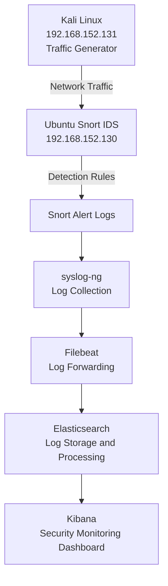

# Lab 5: Network Security Anomaly Detection and Log Management

This project was developed as part of Lab 5 at ESIGELEC. The main objective was to build a network security monitoring system capable of detecting suspicious traffic, collecting alerts, and making the results available for analysis.

The system uses Snort for network traffic detection, syslog-ng and Filebeat for log collection and forwarding, and Elasticsearch and Kibana for storing and visualizing security events.

To evaluate the setup, different types of network traffic were generated from Kali Linux. Five scenarios were tested, covering ICMP, TCP port scanning, SSH and FTP connection anomalies, and UDP traffic.

All five scenarios produced the expected alerts, which were successfully collected and indexed in Elasticsearch.

## 1. Technologies Used

The project combines several tools to handle network monitoring and log management.

Snort is responsible for inspecting network traffic and generating alerts when packets match the configured detection rules. syslog-ng collects these alerts, while Filebeat 9.5.6 forwards them to Elasticsearch 9.5.6.

Elasticsearch handles log processing and storage, and Kibana 9.5.6 provides an interface for searching and visualizing the collected events.

The laboratory environment consists of three machines:

- **Kali Linux:** Used to generate network traffic during testing.
- **Ubuntu Linux:** Runs Snort, syslog-ng, and Filebeat.
- **Linux Mint:** Hosts Elasticsearch and Kibana.

This configuration separates traffic generation, intrusion detection, and log analysis into different parts of the environment.

## 2. System Architecture

The system was designed to separate network traffic detection from log collection, processing, and visualization.

The architecture follows the workflow shown below:

Kali Linux generates the network traffic used during testing. This traffic is inspected by Snort running on the Ubuntu machine. When a packet matches one of the configured rules, Snort generates an alert and writes it to a log file.

The alerts are then collected by syslog-ng and saved in a dedicated file. Filebeat monitors this file and forwards new events to Elasticsearch, where a custom ingest pipeline extracts relevant information from each alert.

Once indexed, the events can be searched and visualized through Kibana.

### Network Configuration

Kali Linux uses the IP address `192.168.152.131`, while the Ubuntu machine uses `192.168.152.130` for laboratory traffic.

Ubuntu also has a second network interface configured with `192.168.56.20`, allowing communication with the Linux Mint host at `192.168.56.1`. Kibana is accessed locally on Linux Mint through `127.0.0.1`.

Separate network interfaces are used on Ubuntu for laboratory traffic, communication with the host, and internet access. This configuration keeps the different network connections organized and allows the monitoring components to communicate.

## 3. Detection Scenarios

Five detection scenarios were configured to evaluate the monitoring system. Each scenario focuses on a different type of network traffic and uses a custom Snort rule.

In addition to checking whether Snort could identify the traffic, each test also verified that the generated alerts were correctly forwarded to Elasticsearch.

### Scenario 01: ICMP Ping Detection

The first scenario focused on ICMP traffic. Ping requests were sent from Kali Linux to the Ubuntu machine at `192.168.152.130`.

A custom Snort rule with SID `1000002` was configured to detect ICMP echo requests and generate the alert message `Someone is pinging`.

The traffic was detected as expected, and the corresponding alerts were found in Elasticsearch.

This initial test confirmed that Snort was monitoring the network interface correctly and that the log collection process was functioning.

### Scenario 02: TCP Port Scanning

The second scenario involved a TCP port scan using Nmap.

Ports 20 through 100 were scanned on the Ubuntu machine to generate SYN packets associated with port scanning activity.

Snort rule `1000003` was configured to detect this traffic. During the test, 81 alerts were generated, corresponding to the 81 scanned ports.

The alerts were also found in Elasticsearch, confirming that the detection and log forwarding process worked for this type of traffic.

### Scenario 03: SSH Connection Anomaly

This scenario tested the detection of repeated TCP connection attempts to port 22, commonly used by SSH.

A threshold-based Snort rule with SID `1000004` was configured to identify multiple SYN packets within a short period.

Repeated connection attempts were generated from Kali Linux, and the rule triggered as expected. The resulting alerts were also indexed in Elasticsearch.

It is important to note that this rule detects unusual connection patterns rather than actual SSH authentication attacks. Repeated SYN packets alone are not enough to confirm a password brute-force attempt.

### Scenario 04: FTP Connection Anomaly

The fourth scenario followed a similar approach, targeting TCP port 21, which is commonly associated with FTP.

Repeated connection attempts were generated from Kali Linux, and Snort rule `1000005` was used to detect activity exceeding a predefined threshold.

The rule generated the expected alerts, which were successfully forwarded to Elasticsearch.

As with the SSH scenario, the detection focuses on repeated connection attempts. It does not analyze FTP login failures or confirm that an authentication attack occurred.

### Scenario 05: UDP Traffic Detection

The final scenario focused on UDP traffic.

A UDP packet was sent from Kali Linux to port 9999 on the Ubuntu machine. A custom Snort rule with SID `1000007` was configured to identify this traffic.

Snort detected the packet and generated an alert, which was later found in Elasticsearch.

This scenario was mainly used to verify UDP traffic detection. It does not simulate a specific intrusion technique.

## 4. Log Collection and Processing

After configuring the detection rules, the next part of the project involved collecting the generated alerts and preparing them for analysis.

Snort stores its alerts in `/var/log/snort/snort.alert.fast`. syslog-ng was configured to collect these entries and write them to `/var/log/lab5/snort-collected.log`.

Filebeat monitors the collected log file and forwards new events to Elasticsearch using HTTPS.

An Elasticsearch ingest pipeline named `snort-lab5-pipeline` was created to process the incoming alerts.

The pipeline extracts information from the raw Snort messages and stores it in structured fields. These include the rule identifier, alert type, network protocol, source and destination IP addresses, alert priority, and port numbers when available.

The main fields are:

- `snort.rule_id`
- `snort.alert_type`
- `snort.protocol`
- `snort.source_ip`
- `snort.destination_ip`
- `snort.source_port`
- `snort.destination_port`
- `snort.priority`

The pipeline also handles differences between Snort alert formats. Some alerts contain classification information, while others do not. ICMP alerts require additional handling because they do not include source and destination port numbers.

This processing makes the data easier to search and filter in Elasticsearch and allows the extracted fields to be used in Kibana visualizations.

The configuration files are available in the `configs/` directory.

## 5. Kibana Dashboard

A custom Kibana dashboard named **Snort Security Monitoring** was created to provide an overview of the collected security alerts.

The dashboard makes it possible to examine the results without manually searching through raw log files.

It contains six panels:

1. Total Snort Alerts
2. Snort Alerts Over Time
3. Snort Alert Types
4. Alerts by Protocol
5. Alerts by Priority
6. Top Source IPs

The time-based visualization shows how alert activity changes during testing. The other panels help identify which detection rules were triggered, which protocols were involved, and where the traffic originated.

The dashboard also makes it easier to compare the results of different scenarios and verify that the information extracted by the ingest pipeline is available for analysis.

### Dashboard Screenshot

The dashboard configuration was exported to `dashboards/snort-security-monitoring.ndjson` and can be imported into another Kibana installation.

## 6. Project Files and Documentation

The repository is organized into separate directories for configuration files, test documentation, screenshots, and supporting scripts.

The `configs/` directory contains the configuration files for Snort, syslog-ng, Filebeat, Elasticsearch, and Ubuntu networking. Each component has its own subdirectory.

The `dashboards/` directory stores the Kibana dashboard export, while `scenarios/` contains documentation for the five detection scenarios.

Screenshots of the tests and dashboard are stored in `docs/screenshots/`, and additional scripts are available in `scripts/`.

The repository also includes documentation covering Filebeat and Elasticsearch integration, along with individual files for the ICMP, TCP scan, SSH, FTP, and UDP tests.

More detailed installation instructions, testing procedures, and results analysis are planned as separate documents.

## 7. Results

All five detection scenarios produced the expected results.

Snort detected the generated traffic according to the configured rules, and the corresponding alerts were found in Elasticsearch.

The TCP port scanning test generated 81 alerts. The SSH and FTP scenarios demonstrated that threshold-based rules could identify repeated TCP connection attempts, while the ICMP and UDP tests confirmed that the system could detect those protocols using custom rules.

The log processing configuration also worked as expected. The Elasticsearch ingest pipeline extracted structured information from the alerts, allowing the events to be filtered and analyzed in Kibana.

The dashboard provided a clearer view of the collected data by grouping alerts according to their type, protocol, priority, and source IP address.

These results confirm that the main components of the monitoring system communicate correctly and that the detection rules work for the traffic generated during the laboratory tests.

## 8. Limitations and Future Improvements

The system was developed and tested in a controlled virtual environment. Its behavior under production network conditions or higher traffic volumes has not yet been evaluated.

Another limitation is the simplicity of some detection rules. Certain network patterns may appear suspicious without necessarily indicating malicious activity.

For example, repeated SYN packets to SSH or FTP ports can suggest unusual connection behavior, but they do not confirm that a brute-force attack is taking place. Detecting authentication attacks more accurately would require additional rules or analysis of authentication logs.

The UDP scenario also focuses on detecting a specific type of traffic rather than identifying a known attack technique.

Future improvements could include more precise detection rules, automatic notifications for important events, and additional scenarios involving other network protocols.

Testing the system with larger traffic volumes would also help evaluate its performance. Improving alert classification and prioritization could make the monitoring dashboard more useful for identifying potentially malicious activity.

## 9. Conclusion

This project demonstrated how network intrusion detection and centralized log management can be combined into a single monitoring system.

Snort, syslog-ng, Filebeat, Elasticsearch, and Kibana were integrated to detect network activity, collect alerts, process the resulting logs, and present the information through a dashboard.

The five test scenarios confirmed that the configured detection rules worked and that the generated alerts could be stored and analyzed in Elasticsearch.

The project also provided practical experience with network monitoring, log processing, and the integration of different security tools.

Although the system is currently limited to a laboratory environment, it provides a foundation for further development, particularly in improving detection accuracy, alert management, and security monitoring capabilities.
