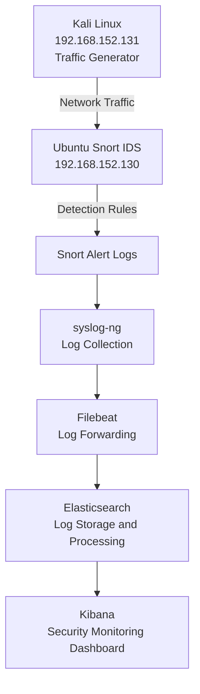
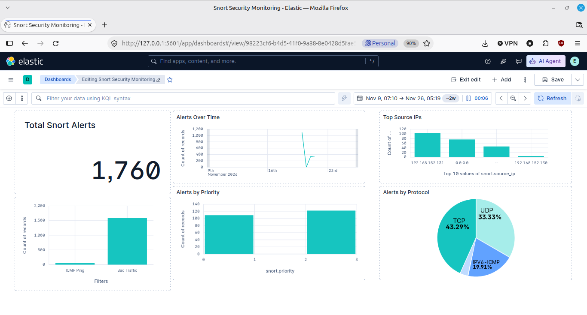

# Lab 5: Network Security Anomaly Detection and Log Management

This project was developed during Lab 5 at ESIGELEC. The objective was to build a network monitoring system capable of detecting suspicious traffic, collecting security alerts, and making them available for analysis.

We used Snort for traffic detection, syslog-ng and Filebeat for log collection and forwarding, and Elasticsearch and Kibana for storing and visualizing the results. To test the system, we generated different types of network traffic from a Kali Linux machine.

We focused on five scenarios: ICMP ping detection, TCP port scanning, repeated SSH and FTP connection attempts, and UDP traffic detection. All five tests produced the expected Snort alerts, which were also found in Elasticsearch.

## 1. Technologies Used

The system was built using several tools that handle different parts of the monitoring process.

Snort was responsible for inspecting network traffic and generating alerts based on our detection rules. We used syslog-ng to collect these alerts and Filebeat 9.5.6 to forward them to Elasticsearch 9.5.6.

Elasticsearch handled log storage and processing, while Kibana 9.5.6 provided an interface to search and visualize the collected data.

For the laboratory environment, we used three machines:

- **Kali Linux:** Generated the traffic used during testing.
- **Ubuntu Linux:** Ran Snort, syslog-ng, and Filebeat.
- **Linux Mint:** Hosted Elasticsearch and Kibana.

This setup allowed us to separate traffic generation, intrusion detection, and log analysis.

## 2. System Architecture

We divided the system into two main parts. The first handles network traffic detection, while the second collects, processes, and displays the generated alerts.

The architecture follows this workflow:

Kali Linux generates the traffic, which is then inspected by Snort running on Ubuntu. When a packet matches one of the configured rules, Snort creates an alert and writes it to a log file.

syslog-ng collects the alerts and saves them in a dedicated file. Filebeat reads this file and sends new events to Elasticsearch, where a custom ingest pipeline extracts information such as IP addresses, protocols, and rule identifiers.

Once the events are indexed, we can access them through Kibana.

### Network Configuration

Kali Linux was configured with the address `192.168.152.131`, while the Ubuntu machine used `192.168.152.130` for laboratory traffic.

Ubuntu also had a second interface at `192.168.56.20`, which allowed it to communicate with the Linux Mint host at `192.168.56.1`. Kibana was accessed locally on Linux Mint through `127.0.0.1`.

We used separate network interfaces on Ubuntu for laboratory traffic, host communication, and internet access. This made it easier to manage the environment and keep the different types of traffic separated.

## 3. Detection Scenarios

To check whether the monitoring system worked correctly, we created five test scenarios. Each one targeted a different type of network activity and used a custom Snort rule.

The objective was not only to verify that Snort could detect the traffic, but also to confirm that the alerts reached Elasticsearch.

### Scenario 01: ICMP Ping Detection

We started with a simple ICMP test. From Kali Linux, we sent ping requests to the Ubuntu machine at `192.168.152.130`.

A custom Snort rule with SID `1000002` was configured to detect these packets and generate the message `Someone is pinging`.

Snort detected the requests, and we were able to find the corresponding events in Elasticsearch. This first test helped us check that the detection and log forwarding process was working before moving on to other scenarios.

### Scenario 02: TCP Port Scanning

For the second test, we used Nmap to scan TCP ports 20 to 100 on the Ubuntu machine.

We wanted to see whether Snort could identify the SYN packets sent during a port scan. The rule used for this scenario had SID `1000003`.

The scan generated 81 alerts, which matched the number of ports tested. We then checked Elasticsearch and confirmed that these alerts had been indexed.

### Scenario 03: SSH Connection Anomaly

In this scenario, we generated repeated TCP connection attempts to port 22.

We used a threshold-based Snort rule with SID `1000004` to detect multiple SYN packets within a short period.

The rule triggered as expected, and the alerts appeared in Elasticsearch.

One important detail is that this test only detects repeated connection attempts. It does not confirm that someone was trying to guess SSH passwords, since we did not analyze authentication failures.

### Scenario 04: FTP Connection Anomaly

The FTP test followed a similar approach. We generated repeated connection attempts from Kali Linux, this time targeting TCP port 21.

Our Snort rule, identified by SID `1000005`, monitored the connection attempts and generated an alert when the configured threshold was reached.

We confirmed that the alerts were created and forwarded correctly.

As with SSH, the rule detects connection patterns rather than actual login attempts. This distinction is important because repeated connections do not always indicate malicious activity.

### Scenario 05: UDP Traffic Detection

For the last scenario, we sent a UDP packet to port 9999 on the Ubuntu machine.

We created a custom Snort rule with SID `1000007` to identify this packet.

The test worked as expected, and the resulting alert was stored in Elasticsearch.

This scenario was mainly intended to verify UDP detection. Unlike the SSH and FTP scenarios, it was not designed to represent a particular attack.

## 4. Log Collection and Processing

After configuring the detection rules, we needed a way to collect the alerts and store them in a format that would be useful for analysis.

Snort writes its alerts to `/var/log/snort/snort.alert.fast`. We configured syslog-ng to collect them and save them in `/var/log/lab5/snort-collected.log`.

Filebeat monitors this second file and forwards the events to Elasticsearch over HTTPS.

On the Elasticsearch side, we created an ingest pipeline called `snort-lab5-pipeline`. Its purpose is to extract information from the raw Snort messages and organize it into separate fields.

For example, the pipeline identifies the rule ID, alert type, protocol, source and destination IP addresses, and alert priority. It also extracts port numbers when they are present.

The main fields include `snort.rule_id`, `snort.alert_type`, `snort.protocol`, `snort.source_ip`, `snort.destination_ip`, `snort.source_port`, `snort.destination_port`, and `snort.priority`.

We had to account for differences between Snort alert formats. Some alerts include classification information, while others do not. ICMP alerts also differ from TCP and UDP alerts because they do not contain source and destination ports.

The pipeline was configured to handle these cases so that the collected events could be processed correctly.

All configuration files related to this part of the project are available in the `configs/` directory.

## 5. Kibana Dashboard

Once the alerts were being indexed correctly, we created a dashboard in Kibana called **Snort Security Monitoring**.

We wanted a simple way to review the results of our tests without having to search through log files or manually inspect individual Elasticsearch documents.

The dashboard contains six visualizations covering the total number of alerts, alert activity over time, alert types, protocols, priorities, and source IP addresses.

The time-based chart helps us see when the tests generated the most activity. The other visualizations make it easier to compare the different scenarios and understand which rules were triggered.

We also included a panel showing the most frequent source IP addresses, which is useful for identifying where the detected traffic originated.

### Dashboard Screenshot

The dashboard was exported to `dashboards/snort-security-monitoring.ndjson` so that it can be imported into another Kibana installation.

## 6. Project Files and Documentation

We organized the repository to keep the configuration files separate from the test documentation.

The `configs/` directory contains the Snort rules, syslog-ng configuration, Filebeat configuration, Elasticsearch ingest pipeline, and Ubuntu network settings. Each component has its own subdirectory.

The Kibana dashboard export is stored in `dashboards/`, while `scenarios/` contains the documentation for the five detection tests.

We also created `docs/screenshots/` to store screenshots of the tests and dashboard. Supporting scripts are kept in `scripts/`.

The repository includes documentation for Filebeat and Elasticsearch integration, along with separate files covering the ICMP, TCP scan, SSH, FTP, and UDP scenarios.

A more detailed installation guide, testing guide, and results analysis are planned as separate documents.

## 7. Results

The five scenarios produced the expected results. In every test, Snort detected the traffic according to our rules, and we confirmed that the corresponding alerts were present in Elasticsearch.

The TCP port scan generated 81 alerts. The SSH and FTP tests showed that threshold-based rules could identify repeated connection attempts, while the ICMP and UDP tests confirmed that our rules could also detect those protocols.

We also verified the log processing part of the system. The custom Elasticsearch pipeline extracted structured fields from the Snort messages, making it possible to filter and analyze the events in Kibana.

Having the alerts available in a dashboard made the results easier to understand. Instead of looking at individual log entries, we could compare alert types, protocols, and activity over time.

These tests confirmed that the different components were communicating correctly and that the monitoring system worked for the traffic generated in our laboratory environment.

## 8. Limitations and Future Improvements

Although the system worked during our tests, it still has some limitations.

The main one is that everything was tested in a controlled virtual network. We did not evaluate the system with real production traffic or under heavy network load.

The detection rules are also relatively simple. Some of them identify traffic that may look suspicious but is not necessarily malicious.

For example, repeated SYN packets to SSH or FTP ports can indicate unusual connection activity, but they do not prove that a brute-force attack is taking place. Detecting actual authentication attacks would require more specific rules or information from authentication logs.

The UDP test is another example. It confirms that Snort can detect UDP packets matching our rule, but it does not identify a particular intrusion technique.

If we continue developing this project, one improvement would be to create more precise detection rules and reduce unnecessary alerts. We could also add automatic notifications for important events, test additional protocols, and evaluate how the system performs with larger amounts of traffic.

Improving alert classification and prioritization would also help make the dashboard more useful for security monitoring.

## 9. Conclusion

In this lab, we built a network monitoring and log management system using Snort, syslog-ng, Filebeat, Elasticsearch, and Kibana.

We tested the setup using five different traffic scenarios and confirmed that the alerts generated by Snort could be collected, processed, stored, and visualized.

The project helped us understand how network intrusion detection and centralized log management can work together. It also gave us practical experience configuring the different tools and troubleshooting the connections between them.

The current system is still a laboratory prototype, but it provides a foundation for exploring more advanced detection rules, alert management, and network security monitoring.
