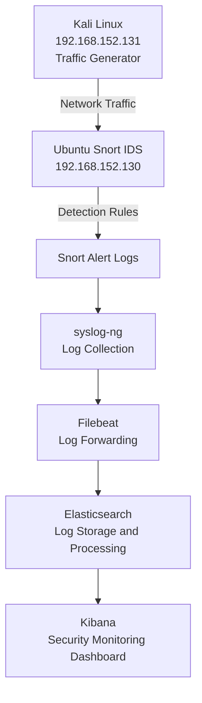

# network-security-anomaly-detection
Anomaly detection and security log management system using Snort, syslog-ng, Elasticsearch and Kibana.
## System Architecture

The project uses a distributed network security monitoring
architecture to detect suspicious traffic, collect security
logs, and visualize alerts.

### Architecture Components

- **Kali Linux:** Generates controlled network traffic to test detection rules.
- **Snort:** Monitors network traffic and generates security alerts.
- **syslog-ng:** Collects Snort security logs.
- **Filebeat:** Forwards collected logs to Elasticsearch.
- **Elasticsearch:** Stores, processes, and indexes security events.
- **Kibana:** Provides dashboards for analyzing network security alerts.

The architecture was validated using five different
network traffic detection scenarios.
