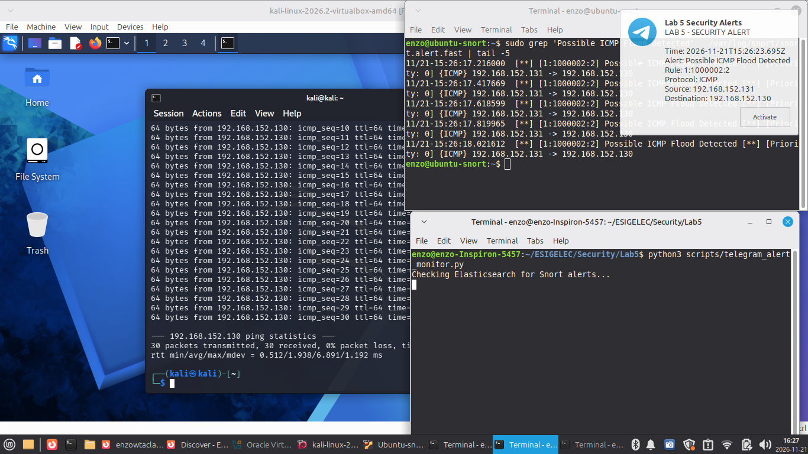
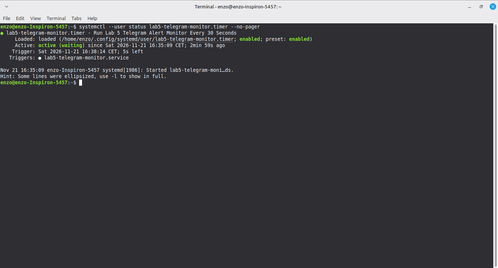
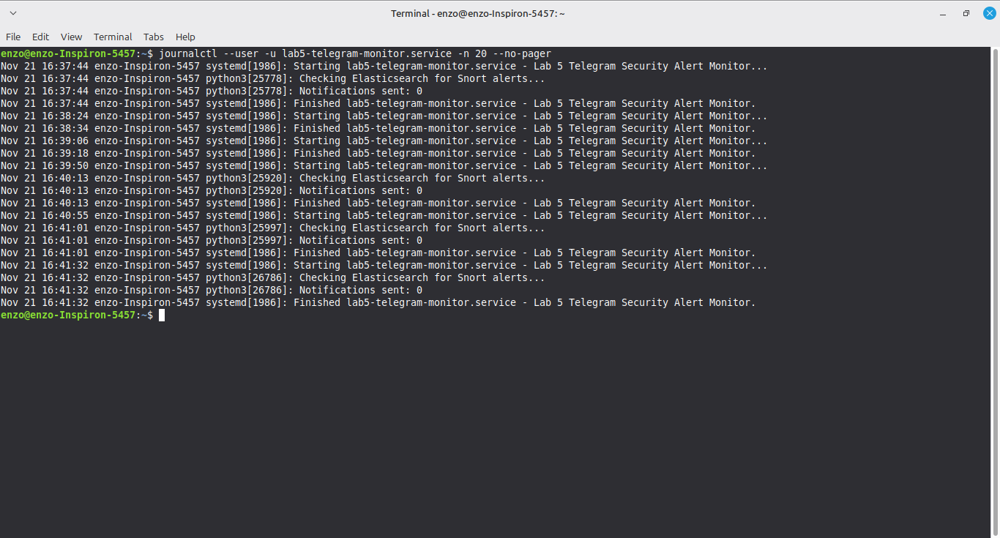

# Telegram Security Notifications

## 1. Overview

The Lab 5 monitoring environment includes automated Telegram notifications for Snort security alerts.

A Python script queries Elasticsearch for recent Snort events and sends notifications through a Telegram bot.

A systemd user timer runs the script periodically without manual intervention.

## 2. Architecture

The notification workflow follows the existing monitoring pipeline:

Kali Linux → Snort → syslog-ng → Filebeat → Elasticsearch → Python Monitor → Telegram

Kali Linux generates controlled test traffic. Snort detects matching network events, and the logging pipeline forwards the alerts to Elasticsearch.

The Python monitor retrieves recent events and sends Telegram notifications.

## 3. Configuration

The notification monitor is implemented in:

`scripts/telegram_alert_monitor.py`

Configuration values are stored locally in:

`scripts/.env`

The configuration includes:

- Telegram bot token
- Telegram chat ID
- Elasticsearch URL
- Elasticsearch username and password
- Elasticsearch CA certificate path

The `.env` file contains sensitive credentials and must not be committed to Git.

The monitor uses HTTPS certificate verification when connecting to Elasticsearch.

## 4. Alert Processing

The monitor:

1. Queries Elasticsearch for Snort alerts from the previous 10 minutes.
2. Identifies events that have not been processed.
3. Groups new events by Snort rule ID, source IP, and destination IP.
4. Sends one Telegram message per group.
5. Stores processed event identifiers locally to prevent duplicate notifications.

The local state file is:

`scripts/.telegram_alert_state.json`

This file is excluded from version control.

## 5. Automatic Execution

A systemd user service runs the Python monitor.

Service:

`lab5-telegram-monitor.service`

Timer:

`lab5-telegram-monitor.timer`

The timer schedules a new execution approximately 30 seconds after the previous service execution becomes inactive.

The timer can be checked with:

```bash
systemctl --user status lab5-telegram-monitor.timer
```

Service logs can be inspected with:

```bash
journalctl --user -u lab5-telegram-monitor.service -n 20 --no-pager
```

The timer operates while the user's systemd manager is running.

## 6. Validation

The integration was tested using the ICMP Flood detection scenario.

Test command executed on Kali Linux:

```bash
ping -c 30 -i 0.2 192.168.152.130
```

The test generated Snort alerts that were indexed in Elasticsearch.

The first notification test sent 10 individual messages.

After implementing alert grouping, a repeated ICMP test produced a single grouped Telegram notification.

A final test confirmed that the systemd timer executed the monitor automatically and delivered the notification without manually running the Python script.

## 7. Evidence

### Telegram Alert



### systemd Timer



### Automatic Notification


