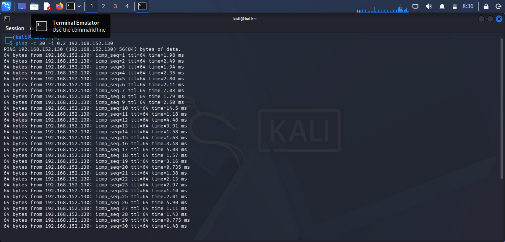
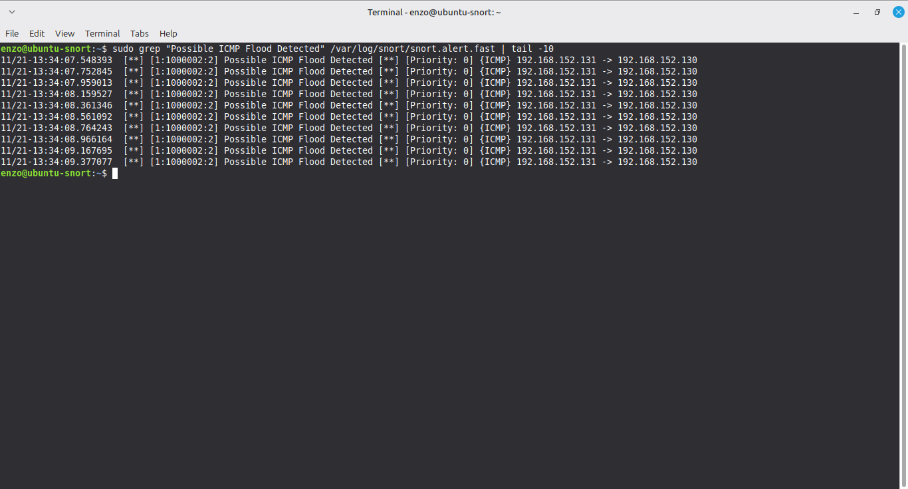
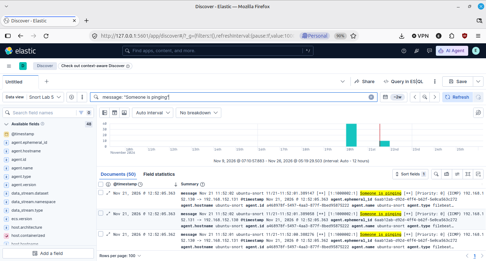

# Scenario 01: ICMP Flood Detection

## 1. Objective

This scenario checks whether Snort can identify a short burst of network traffic that exceeds a configured threshold.

Detect a short burst of ICMP echo requests exceeding the configured rate threshold.

## 2. Test Environment

Kali Linux (`192.168.152.131`) generated the traffic. Snort monitored the laboratory network on Ubuntu (`192.168.152.130`). Alerts were collected through syslog-ng and Filebeat and sent to Elasticsearch for analysis in Kibana.

## 3. Test Procedure

The following command was executed on Kali Linux:

```bash
ping -c 30 -i 0.2 192.168.152.130
```

Snort rule `1000002`, revision 2, was configured with `detection_filter:track by_src, count 20, seconds 10`.

The expected alert was:

```text
Possible ICMP Flood Detected
```

On Ubuntu, the generated alerts can be checked with:

```bash
sudo grep 'Possible ICMP Flood Detected' /var/log/snort/snort.alert.fast | tail -10
```

## 4. Results

Snort generated multiple alerts with identifier `[1:1000002:2]`. Elasticsearch returned the corresponding events with structured rule, protocol, and IP address fields.

## 5. Evidence

### Traffic generated from Kali Linux



### Snort alert output



### Kibana / Elasticsearch evidence



## 6. Limitations

This test detects elevated ICMP traffic over a short period. It does not demonstrate an actual denial of service.

The rule detects matching traffic patterns. An alert alone is not proof of malicious intent.

[Back to the main README](../../README.md)
