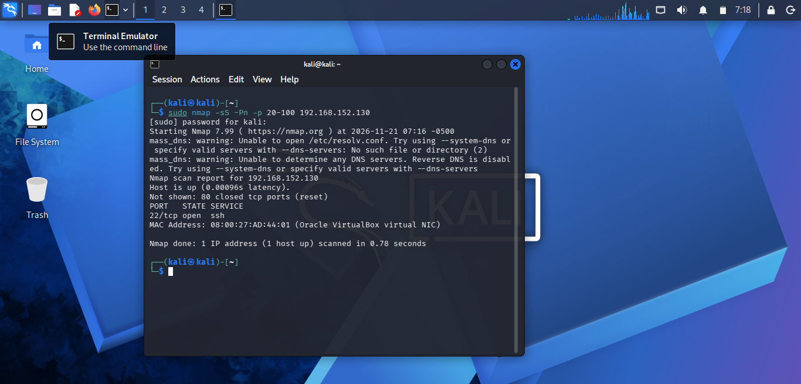
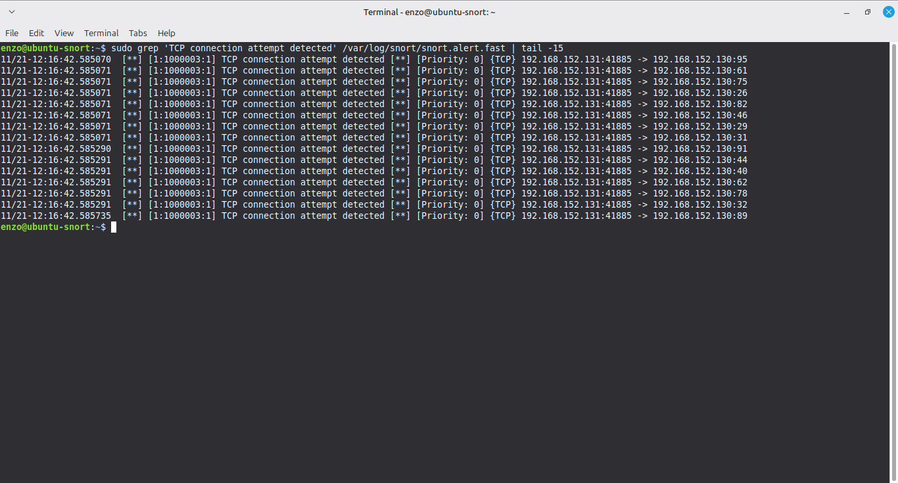
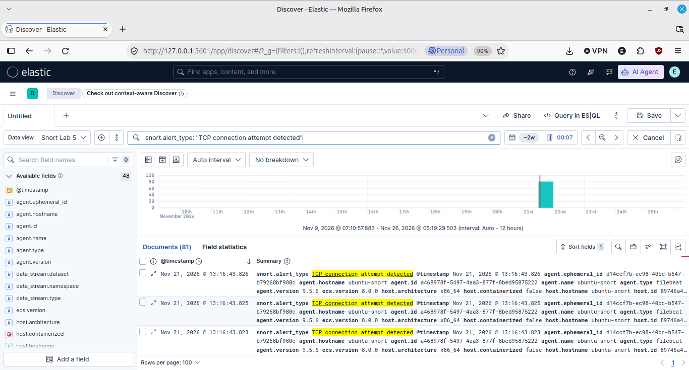

# Scenario 02 — TCP Port Scan Detection

## Objective

Detect TCP SYN packets generated during a scan of ports 20 through 100.

## Test Environment

- **Traffic generator:** Kali Linux (`192.168.152.131`)
- **Detection machine:** Ubuntu Snort (`192.168.152.130`)
- **Monitoring tools:** Snort, syslog-ng, Filebeat, Elasticsearch, and Kibana

## Test Command

Run the following command on Kali Linux:

```bash
sudo nmap -sS -Pn -p 20-100 192.168.152.130
```

## Expected Detection

- **Snort rule ID:** `1000003`
- **Expected alert:** `TCP connection attempt detected`

## Verification

On Ubuntu, check the Snort alert log:

```bash
sudo grep -F 'TCP connection attempt detected' /var/log/snort/snort.alert.fast | tail -5
```

Then verify that the corresponding event appears in Elasticsearch using Kibana Discover or Dev Tools.

## Result

The test generated 81 alerts in Elasticsearch, corresponding to the scanned TCP ports.

## Evidence

### Evidence 1



### Evidence 2



### Evidence 3



## Limitations

The rule detects individual SYN packets rather than correlating them into a single port-scanning event.

[Back to the main README](../../README.md)
