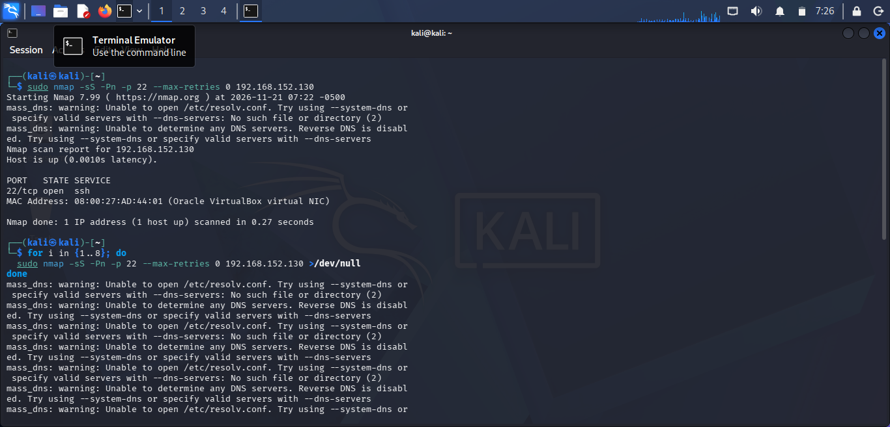
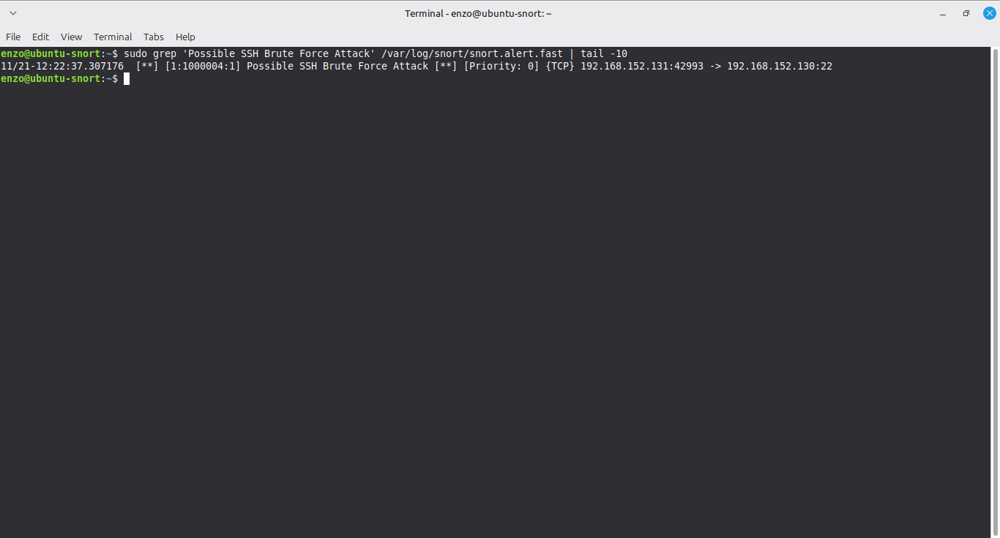

# Scenario 03 — SSH Connection Anomaly

## Objective

Detect repeated TCP connection attempts to SSH port 22.

## Test Environment

- **Traffic generator:** Kali Linux (`192.168.152.131`)
- **Detection machine:** Ubuntu Snort (`192.168.152.130`)
- **Monitoring tools:** Snort, syslog-ng, Filebeat, Elasticsearch, and Kibana

## Test Command

Run the following command on Kali Linux:

```bash
for i in {1..8}; do sudo nmap -sS -Pn -p 22 --max-retries 0 192.168.152.130 >/dev/null; done
```

## Expected Detection

- **Snort rule ID:** `1000004`
- **Expected alert:** `Possible SSH Brute Force Attack`

## Verification

On Ubuntu, check the Snort alert log:

```bash
sudo grep -F 'Possible SSH Brute Force Attack' /var/log/snort/snort.alert.fast | tail -5
```

Then verify that the corresponding event appears in Elasticsearch using Kibana Discover or Dev Tools.

## Result

Snort detected the repeated connection attempts, and the alert was indexed in Elasticsearch.

## Evidence

### Evidence 1



### Evidence 2



### Evidence 3


## Limitations

This scenario does not test password guessing or authentication failures. The rule detects repeated SYN packets.

[Back to the main README](../../README.md)
