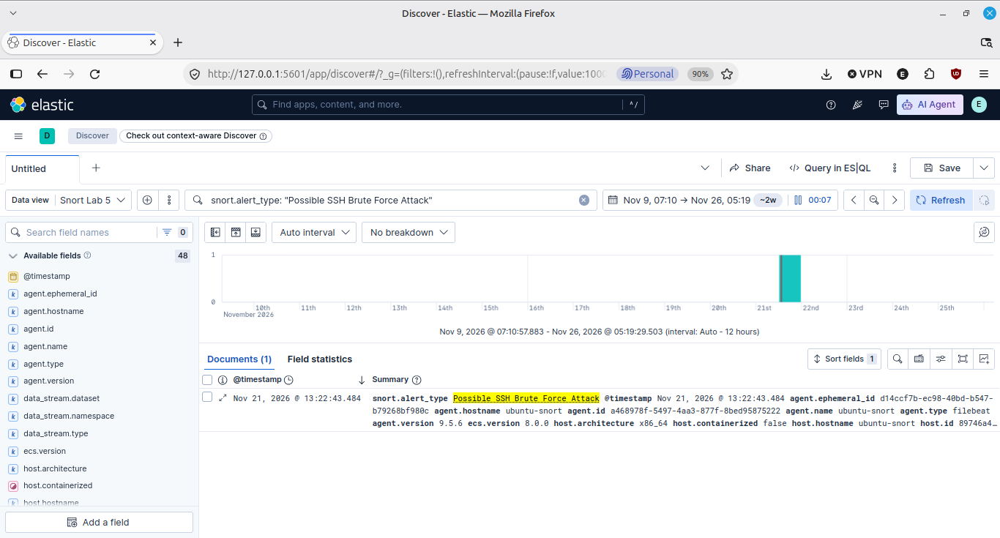

# Scenario 03 — SSH Connection Anomaly

## 1. Objective

The third scenario examined repeated TCP SYN connection attempts to port 22, normally used by SSH.

The purpose was to check whether the configured Snort rule detected the traffic and whether the alert reached Elasticsearch.

## 2. Test Environment

Kali Linux (`192.168.152.131`) generated the traffic. Snort monitored the laboratory network on Ubuntu (`192.168.152.130`). syslog-ng and Filebeat collected and forwarded the alerts to Elasticsearch, where they could be examined using Kibana.

## 3. Test Procedure

The following command was executed on Kali Linux:

```bash
for i in {1..8}; do sudo nmap -sS -Pn -p 22 --max-retries 0 192.168.152.130 >/dev/null; done
```

Snort rule `1000004` was configured to generate the message:

```text
Possible SSH Brute Force Attack
```

On Ubuntu, the alert can be checked using:

```bash
sudo grep -F 'Possible SSH Brute Force Attack' /var/log/snort/snort.alert.fast | tail -5
```

## 4. Results

The configured threshold was reached and Snort generated the expected alert. The corresponding event was indexed in Elasticsearch.

## 5. Evidence

### Traffic generated from Kali Linux


### Snort alert output


### Kibana / Elasticsearch evidence



## 6. Limitations

The test did not involve password guessing or failed logins. The alert message refers to a possible brute-force attack, but the rule only measures repeated connection attempts.

[Back to the main README](../../README.md)
