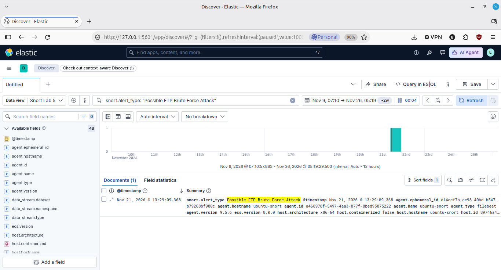

# Scenario 04 — FTP Connection Anomaly

## Objective

Detect repeated TCP connection attempts to FTP port 21.

## Test Environment

- **Traffic generator:** Kali Linux (`192.168.152.131`)
- **Detection machine:** Ubuntu Snort (`192.168.152.130`)
- **Monitoring tools:** Snort, syslog-ng, Filebeat, Elasticsearch, and Kibana

## Test Command

Run the following command on Kali Linux:

```bash
for i in {1..8}; do sudo nmap -sS -Pn -p 21 --max-retries 0 192.168.152.130 >/dev/null; done
```

## Expected Detection

- **Snort rule ID:** `1000005`
- **Expected alert:** `Possible FTP Brute Force Attack`

## Verification

On Ubuntu, check the Snort alert log:

```bash
sudo grep -F 'Possible FTP Brute Force Attack' /var/log/snort/snort.alert.fast | tail -5
```

Then verify that the corresponding event appears in Elasticsearch using Kibana Discover or Dev Tools.

## Result

Snort generated the expected alert, and Elasticsearch indexed the event with destination port 21.

## Evidence

### Evidence 1


### Evidence 2


### Evidence 3



## Limitations

The detection is based on repeated connection attempts, not failed FTP logins.

[Back to the main README](../../README.md)
