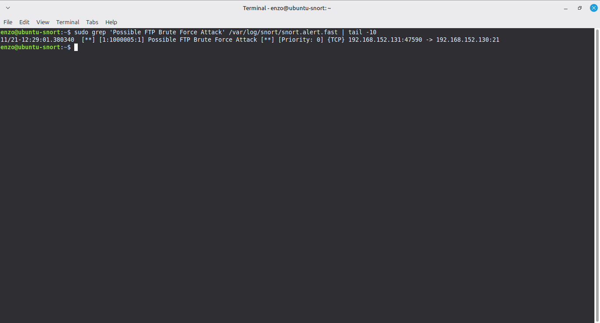

# Scenario 04 — FTP Connection Anomaly

## 1. Objective

The fourth scenario examined repeated TCP SYN connection attempts to port 21, normally used by FTP.

The purpose was to check whether the configured Snort rule detected the traffic and whether the alert reached Elasticsearch.

## 2. Test Environment

Kali Linux (`192.168.152.131`) generated the traffic. Snort monitored the laboratory network on Ubuntu (`192.168.152.130`). syslog-ng and Filebeat collected and forwarded the alerts to Elasticsearch, where they could be examined using Kibana.

## 3. Test Procedure

The following command was executed on Kali Linux:

```bash
for i in {1..8}; do sudo nmap -sS -Pn -p 21 --max-retries 0 192.168.152.130 >/dev/null; done
```

Snort rule `1000005` was configured to generate the message:

```text
Possible FTP Brute Force Attack
```

On Ubuntu, the alert can be checked using:

```bash
sudo grep -F 'Possible FTP Brute Force Attack' /var/log/snort/snort.alert.fast | tail -5
```

## 4. Results

Snort generated the expected alert and Elasticsearch indexed the event with destination port 21.

## 5. Evidence

### Traffic generated from Kali Linux


### Snort alert output



### Kibana / Elasticsearch evidence


## 6. Limitations

The test did not attempt to authenticate to an FTP service. The rule detects repeated connection attempts, not actual failed login attempts.

[Back to the main README](../../README.md)
