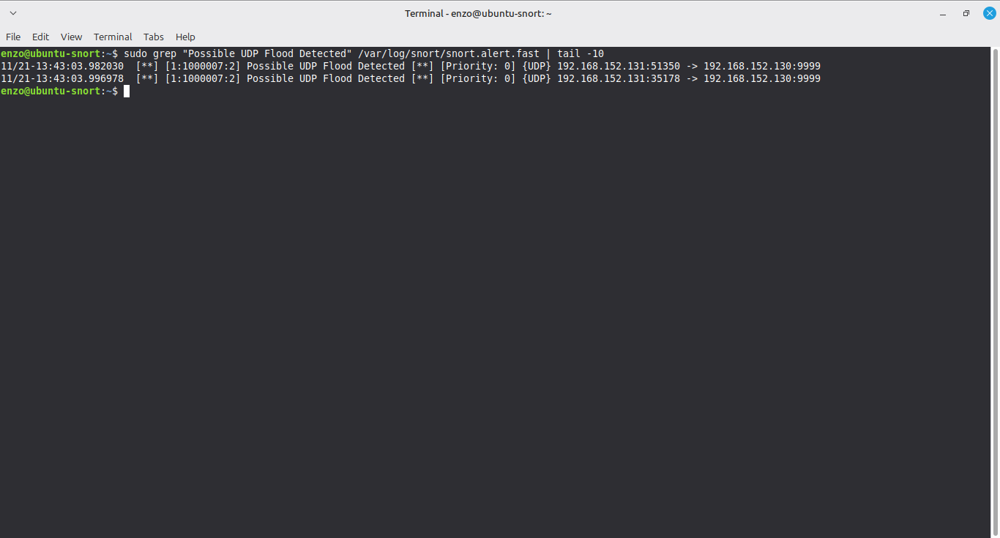
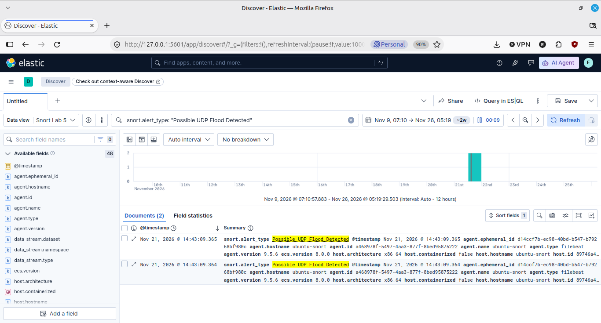

# Scenario 05 — UDP Traffic Detection

## Objective

Detect UDP traffic sent from Kali Linux to destination port 9999.

## Test Environment

- **Traffic generator:** Kali Linux (`192.168.152.131`)
- **Detection machine:** Ubuntu Snort (`192.168.152.130`)
- **Monitoring tools:** Snort, syslog-ng, Filebeat, Elasticsearch, and Kibana

## Test Command

Run the following command on Kali Linux:

```bash
echo "LAB5 UDP test" | nc -u -w1 192.168.152.130 9999
```

## Expected Detection

- **Snort rule ID:** `1000007`
- **Expected alert:** `LAB5 UDP Traffic Detected`

## Verification

On Ubuntu, check the Snort alert log:

```bash
sudo grep -F 'LAB5 UDP Traffic Detected' /var/log/snort/snort.alert.fast | tail -5
```

Then verify that the corresponding event appears in Elasticsearch using Kibana Discover or Dev Tools.

## Result

Snort generated the UDP alert, and Elasticsearch indexed the event with parsed network fields.

## Evidence

### Evidence 1


### Evidence 2



### Evidence 3



## Limitations

This test validates the UDP detection rule but does not represent a specific intrusion technique.

[Back to the main README](../../README.md)
