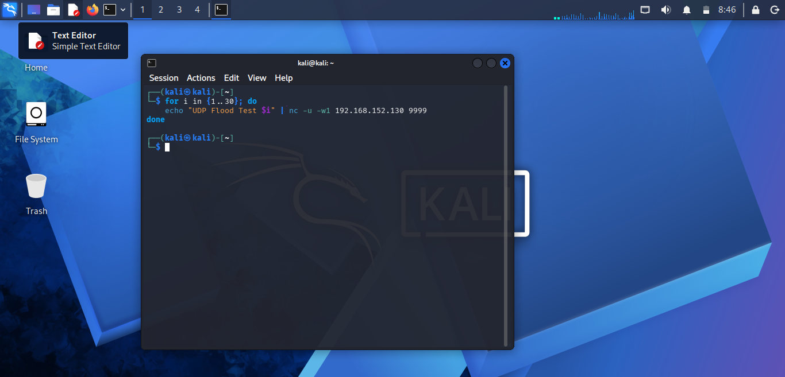

# Scenario 05: UDP Flood Detection

## 1. Objective

This scenario checks whether Snort can detect a short burst of UDP packets sent to port 9999 when the traffic exceeds the configured rate threshold.

## 2. Test Environment

Kali Linux (`192.168.152.131`) generated the traffic. Snort monitored the laboratory network on Ubuntu (`192.168.152.130`). Alerts were collected through syslog-ng and Filebeat and sent to Elasticsearch for analysis in Kibana.

## 3. Test Procedure

The following command was executed on Kali Linux:

```bash
for i in {1..30}; do
    echo "LAB5 UDP Flood Test $i" | nc -u -w1 192.168.152.130 9999
done
```

Snort rule `1000007`, revision 2, was configured with `detection_filter:track by_src, count 20, seconds 10`.

The expected alert was:

```text
Possible UDP Flood Detected
```

On Ubuntu, the generated alerts can be checked with:

```bash
sudo grep 'Possible UDP Flood Detected' /var/log/snort/snort.alert.fast | tail -10
```

## 4. Results

Snort generated two alerts with identifier `[1:1000007:2]`, showing UDP packets from Kali Linux to destination port 9999. The indexed UDP flood event should be confirmed in Kibana before final submission.

## 5. Evidence

### Traffic generated from Kali Linux



### Snort alert output


### Kibana / Elasticsearch evidence


## 6. Limitations

This test identifies an elevated packet rate in a controlled burst. It does not establish that the target became unavailable.

The rule detects matching traffic patterns. An alert alone is not proof of malicious intent.

[Back to the main README](../../README.md)
